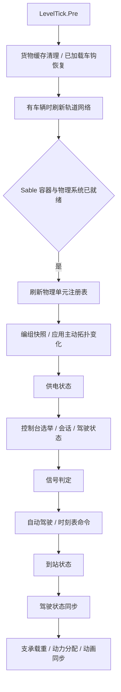

# 代码结构与运行约定

本文描述当前实现，供后续修改前定位数据归属和执行入口。详细行为仍以源码和对应回归检查为准。

## 世界执行入口

`GuidedRailways` 注册事件，`TrainRuntime` 负责跨模块的推进顺序。物品放置、查询接口和单个方块实体恢复不能推进整列车的世界更新。

此顺序沿用重构前的实际调用顺序。`VehiclePhysics.refresh` 返回本次更新使用的单元列表；编组会进一步过滤失效和过期单元。列表容器不可修改，单元本身仍是可更新的运行对象，不是深度不可变快照。

- **物理子步**：先 `VehiclePhysics.step`，再 `CouplerConnections.step`。轨道约束、脱轨判断、物理接触与车钩关节在这里更新，不额外执行时刻表
- **LevelTick.Post**：先发布原生列车身份，再发布信号状态
- **世界卸载**：先释放物理单元，再清理轨道、车钩、驾驶会话、编组、原生身份、货物、Railway 及电力运行状态。可选对接模块另外注册自身资源的卸载清理
- **局部构造**：放置和搬移只初始化对应平台，不调用 `TrainRuntime`。`ScheduleLifecycleCheck` 和 `TrainRuntimeCheck` 检查这一边界

## 持久数据与运行对象

### 平台与转向架

`MountEntity` 保存下部物理体 UUID、载重及转盘参考等平台状态；`MountHandoff` 保存正常搬移的待完成交接。下部 Sable 物理体的用户数据通过 `BogieMountBinding` 保存所属平台的维度和位置，以及 `MountOwnership` 的搬移版本。

`MountOwnership` 是不依赖 Minecraft 的纯规则：位置可被后来的平台复用，版本不能，因此“A→B→A”读回的是版本 2，而不是最初那次占用。`MountHandoff` 同时保存授权时观察到的来源版本，提交即对归属做一次比较并交换：来源位置或版本不再吻合时拒绝，不覆盖更新的归属；版本缺失（旧存档、或授权时下部物理体尚未加载）仍按位置规则处理，避免把来不及观测的正常搬移判成副本。

`VehiclePhysics.Unit` 只保存运行时物理体引用、关节、轨道采样和命令。活动注册表可以重建，不能替代持久归属。交接先提交归属，再恢复关节；再次搬移必须使用已提交的位置作为来源。平台副本不能凭复制的下部 UUID 接管原件。

`Unit.ready(tick)` 统一编组、路线准备和物理接触共有的判断：车体、下部和平台均未移除，最近一次初始化不超过两刻。它不表示已经上轨，也不代替区块、实际方块身份或持久归属检查。不同用途的拆除校验、短暂恢复窗口仍各自保留。

### 编组与车钩

`CouplerConnections` 管理实际连接、约束及恢复；`TrainConsists` 将车体连接关系整理为当前世界的共享编组快照。驾驶选举、信号、原生身份和货运均读取这个成员关系。路线方向和前后顺序不能仅由无向编组集合推断，仍由相应方向／路线模块计算。

已连挂端点的位置随 `CouplerSavedData` 保存在当前维度的连接记录中。原件未加载时，异地副本仍不能凭复制的 UUID 恢复或删除原连接。正常搬移的 `CouplerHandoff` 请求随端点 NBT 保存，`CouplerTransfers` 只适配回调，不再保存临时交接表或超时表。目标就绪后提交归属、更新请求来源，再恢复插座几何；等待中的连续搬移保留原世界几何，同一已提交交接可以重试。解挂同时释放两端的位置记录，避免积累已无连接的身份。旧存档缺少位置时首次登记，无法追溯识别登记前已有的副本。稳定性边界与固定验收场景见 `STABILITY_BASELINE.md`。

主动连挂或拆分通过 `TrainConsists.changed` 排队，在世界更新中统一应用。加载、卸载造成的引用失效只使快照失效，不等同于玩家主动改变编组，不应随意清空时刻表进度。

### 驾驶、自动运行与动力

- `DriverControls` 管理控制台注册、最早控制台选举、操作会话和驾驶状态；`refresh` 准备状态，`publish` 同步结果
- `ScheduleController` 独占时刻表物品及可变执行状态；外部模块通过方法请求状态转换，不能直接拼写内部进度
- `AutomaticTrains` 读取编组、目的地、信号和时刻表，生成自动运行命令；`StationPresence` 管理实际停靠状态
- `TrainCommand` 表达本次驾驶意图；`VehicleTraction` 统一动力分配和纵向力计算；`TrainElectricity` 提供电力能力，物理模块执行结果
- `ConsistRoutes` 管理编组行驶路线和后车跟随历史；`TrackNetwork` 管理轨道采样和分支，不能另建独立的列车成员真相

本轮没有调整速度、牵引力、制动、轨道导向、脱轨或碰撞参数。

重新上轨由 `VehiclePlacement` 规划整节车体的所有目标姿态；`RerailSpace` 在 `MoveBatch` 开始移动前读取实际物理碰撞形状，检查车体及全部转向架与地形和其他物理体的重叠。同次移动的部件不互相判为障碍，单轨轮组与世界单轨之间沿用现有接触豁免；车体其他部件不享有该豁免。查询不主动加载区块，超过检查预算会拒绝操作，防止复杂车体无限占用交互处理时间。

## 原生铁路身份桥接

`NativeTrainBridge` 为符合条件、具有有效控制台的物理编组发布 Create 列车身份。`PhysicalTrainProxy` 面向查询与集成，不成为第二个驾驶／时刻表执行器。

原生站点、信号、导航与小地图适配读取桥接状态；真正的物理运动仍由本模组执行。列车名称、进度和货物视图应从实际控制台及物理编组派生，不能同时维护另一套互相覆盖的持久事实。

## 货物访问与缓存

真实物品和流体留在各物理车体的容器中。`CargoStorage` 读取内容并生成只读快照；`PhysicalCargoManager` 按实际车厢提供原生查询视图。真正的传输通过明确的对接端点和限域处理器执行，不能向原生查询视图开放整列任意写入。

`ConsistCache` 的三个状态必须区分：

1. **可读**：`get` 可以返回快照，多车体别名共享捕获对象与标记
2. **已失效**：`get` 返回空，标记改变；`previous` 仅保留比较基线，重扫后用于判断真实内容是否变化
3. **已丢弃**：物理体删除、缓存替换或过期时释放别名及基线，不能继续比较

失效本身不代表发生了货物运输。`CargoClock` 根据已知真实传输或可比较快照的实际变化更新活动时间，避免普通方块实体变化被误算为运输，也避免丢失基线后过早满足空闲等待。

`StorageIdentities` 以弱引用核对容器身份，每个共享捕获每游戏刻最多校验一次；方块实体加入、替换和移除通知会即时使相关捕获失效。未经过已知传输通知的普通内容变化仍采用原有周期轮询。失效基线也受过期清理约束，不无限保留。

## 外围适配与显示

- Railway、Blocks & Bogies 的车型选择、模型和动画经兼容模块接入；几何目录负责平台高度和碰撞布局
- CEE、Simulated、Hose Connectors 和 Automated Logistics 在供电或货物边界接入，不拥有本模组时刻表执行状态
- 客户端模型、HUD、界面与网络包只呈现或请求操作；驾驶权限及有效性在服务端判定
- 玩家可见语言、提示和界面遵循 `project-style.json` 与 `PROJECT_STYLE.md`

## 验证边界

标准离线构建覆盖编组、车钩恢复、实际 NBT 交接、时刻表生命周期、货物缓存、信号模型、动画和适配契约等检查。`TrainRuntimeCheck` 检查跨模块调用顺序以及禁止在底层模块隐藏全局推进。

这些检查不代替真实物理世界、Mixin 实际加载、客户端渲染或玩家验收，也不证明真实 CPU／内存占用下降。已有未登记历史物理体在首次有效初始化时登记归属；没有历史记录的数据无法追溯区分已存在的副本。
